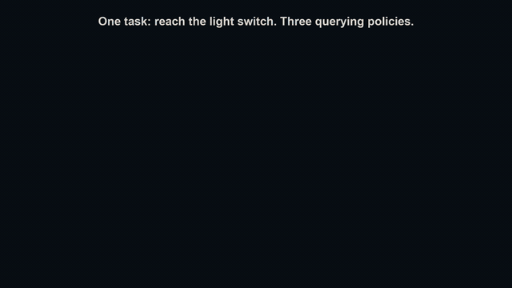
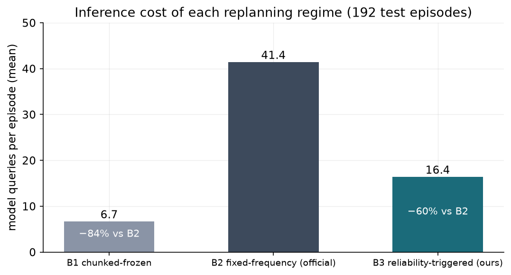
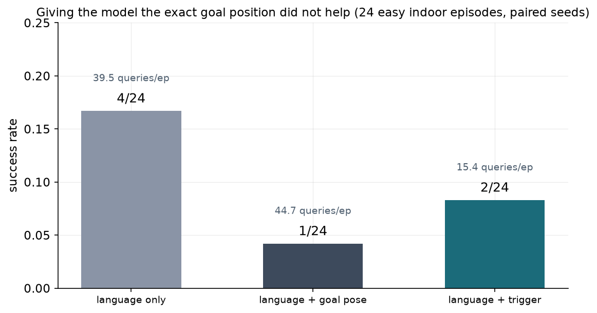

# VLA-NAV

A reproducibility and efficiency study of OmniVLA, an 8-billion-parameter
vision-language-action model for robot navigation, running in the AI2-THOR
simulator on two NVIDIA T4 GPUs.

Deployed VLAs are usually queried at every control step. Each query of this
model took about 4 seconds. This study measures how many of those queries
actually matter, what the model can and cannot do indoors, and what happens
when it is given more information about the goal.

*Loop from the overview video (`results/videos/vlanav_overview.mp4`): the
same episode run under three query policies. Text on each view is the live
robot state - policy, step, speed, distance to goal.*

## Method

**Setup.** The released OmniVLA checkpoint (step 120000, bf16) is loaded
across two T4s through its official inference path. The robot operates in
AI2-THOR 5.0.0, rendered headless at 400x400. Goals are given as plain
language ("Go to the toaster"); the camera frame is never augmented with
markers. The model outputs an 8-waypoint plan, decoded by the official PD
controller at 3 Hz.

**Pipeline.** The study ran as a sequence of standalone experiment scripts
under `experiments/` - these are the exact files that executed on the
Kaggle workers: load the checkpoint and measure latency (00), bring up the
renderer (01), a small pilot to sanity-check the loop (02), the trigger
threshold sweep on validation scenes only (03), the 192-episode test matrix
split across two runs (04a/04b), recorded demonstrations (06), and two
diagnostics on the easiest tasks (08). Every experiment appends one row per
finished episode to its own log with the scene, seeds, threshold source and
model identity attached, so a session dying mid-run loses nothing.

**Query policies compared.** Three regimes share the same model, simulator,
action decoder, and episode budget:

- B1 asks the model once every 8 steps and follows the plan in between.
- B2 asks at every step (the official deployment regime).
- B3 asks every 8 steps like B1, but re-queries early when either of two
  cheap onboard checks fails: the distance the robot was commanded to move
  exceeds the distance it actually moved by more than a threshold, or the
  robot has stalled for several consecutive steps.

**Protocol.** Validation scenes (FloorPlan1-30) were used only to pick the
B3 trigger threshold (0.2 m, stall limit 2). The test split
(FloorPlan401-430) produced all reported numbers. Conditions: in-distribution
scenes, unseen scenes, paraphrased instructions, and spawns facing away from
the goal. 16 episodes per condition per regime, identical seeds across
regimes, 60-step budget. The analysis refuses to run if a trigger threshold
cannot be traced to the validation split, and excludes any row not produced
by the real model.

**Follow-up experiments.** The main matrix raises the question of why the
model fails indoors at all. Two diagnostic runs probe this on the easiest
tasks: a 20-episode pilot, and a 24-episode sweep that adds the model's
second official goal interface (goal position as coordinates) on the same
episodes and seeds.

## Results

Main test matrix, 192 episodes, pooled over the four conditions:

| Query policy | Success rate | Queries / episode | Pure inference / episode |
|---|---|---|---|
| B1: plan-following | 0.03 | 6.7 | 28 s |
| B2: every step (official) | 0.02 | 41.4 | 175 s |
| B3: reliability-triggered | 0.03 | **16.4** | **70 s** |

Wilson 95% intervals, per-condition tables, and exact McNemar tests on the
paired episodes are in `results/analysis/full_analysis.md`. Success rates
do not differ significantly at this sample size; the inference cost does.
Path efficiency is reported only as a straight-line proxy - see the
limitations below.

**Finding 1 - most every-step queries can be skipped at equal measured
success.** B3 matches B2's measured success while issuing 60% fewer
queries. The signal is odometry
only: it detects when the robot stops moving as commanded.

**Finding 2 - indoor transfer is the real wall.** On 20 episodes with the
goal less than 2.5 m away in a straight line, B2 succeeded 4 times. The
robot collided with the environment about 26 times per episode and often ended
farther from the goal than where it started. OmniVLA's training data is
mostly outdoor robot data (LeLaN, GNM, Frodobots, BDD - Hirose et al. 2025,
arXiv:2509.19480); this is a transfer failure, reported as measured.

**Finding 3 - more spatial information did not help.** On 24 paired easy
episodes, giving the model the exact goal coordinates through its official
pose-input mode (modality 8) made success worse: 4/24 (language only)
dropped to 1/24 (language + goal position), with more collisions. The
bottleneck is not goal grounding. The goal position is privileged
simulator information in this experiment and is labelled as such.

## What this study does not show

- Success rates are near the floor in every cell, and the sample is small.
  No claim is made that B3 improves success over B2 - only that it costs
  far less at the same measured success.
- The straight-line efficiency metric ignores walls; true path-length SPL
  is unavailable here because AI2-THOR returned no path for almost every
  furniture-object goal in our scans - the object centre is usually off the
  navigation mesh, so the shortest-path field is empty in all logged
  episodes.
- The reliability signal is odometry only; it cannot see an obstacle before
  contact.
- Simulation only. No claim transfers to physical hardware.

## Repository

- `results/raw/` - the evidence: one `episodes.jsonl` + `meta.json` per
  experiment, written at run time and never edited afterwards.
- `results/analysis/` - tables recomputed from the raw logs by
  `scripts/analyze_full.py` (Wilson intervals, exact McNemar, paired
  bootstrap).
- `results/figures/`, `results/videos/` - figures and the overview video,
  generated by `scripts/make_figures.py` and `scripts/make_promo_video.py`.
- `experiments/` - the exact scripts that executed on the Kaggle workers,
  one per experiment, in running order (00 preflight ... 08b bottleneck).
- `kaggle_notebooks/<name>/output/` - fetched run artifacts (logs, raw
  rows, demo videos) for the diagnostic runs that are not duplicated under
  `results/raw/`. The kernel pages may show status ERROR where a post-run
  cell failed after the experiment finished; the episode logs are flushed
  per episode and were verified with `scripts/verify_raw.py`.
- `src/vlanav/` - the environment wrapper, policy adapter, query policies,
  and logging.
- `scripts/` - the analysis pipeline: verification, statistics, figures,
  video, and the kernel-output fetcher.
- `tests/` - offline pytest suite over a mock simulator (no GPU needed).

## Credits

OmniVLA: N. Hirose et al., "OmniVLA: An Omni-Modal Vision-Language-Action
Model for Robot Navigation" (arXiv:2509.19480, ICRA 2026), UC Berkeley BAIR
/ Toyota ([code](https://github.com/NHirose/OmniVLA), MIT licence). This
study uses the released checkpoint unmodified.
Simulator: AI2-THOR, Allen Institute for AI.
Compute: Kaggle free tier, 2x T4.
